<a href="https://www.easirmahi.top">
  
</a>

<div align="center">

# Easir Iqbal Mahi

<h4>Full-stack Software Developer · Founder @ Lagbeto</h4>

```text
TypeScript • Python • Go • Nodejs • JavaScript • Java • Flutter • Kotlin 
```

<p align="center">
  <a href="https://www.easirmahi.top" target="_blank"></a>
  <a href="https://www.linkedin.com/in/easirmahi/" target="_blank"></a>
  <a href="https://github.com/Sosuke-d-Mahi" target="_blank"></a>
  <a href="mailto:easiriqbalmahi@gmail.com"></a>
</p>

</div>

> <h3>I don’t seek approval, I seek superiority then I build until reality has no choice but to agree.</h3> 

 Currently working at **I'm currently working on my own Startup called Lagbeto**

 Learning **I'm Learning Talking face to face skill :)**

 Looking to collaborate on **I wanna collaborate with pro Full-stack devs**

 Featured project: **https://github.com/Sosuke-d-Mahi/api-docs.git**

 In my free time **Love playing games and modding those games ^_~**

### 💼 Experience

- **Founder & Lead Architect** at **Lagbeto** (2026 – Present)
  - Leading core product architecture, distributed services in Go and Node.js, and mobile applications in Flutter.
- **Full-Stack Software Developer** (2024 – 2026)
  - Engineered production systems, developer tooling (`api-docs`), and reverse-engineered game engine modifications.

---


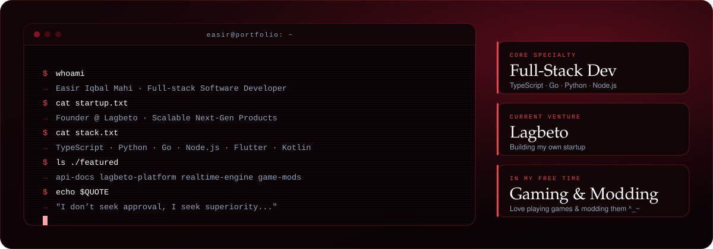

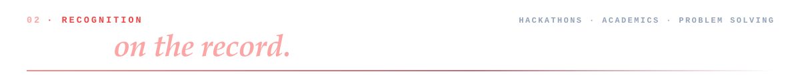

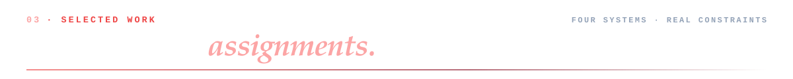

<a href="https://github.com/Sosuke-d-Mahi/api-docs">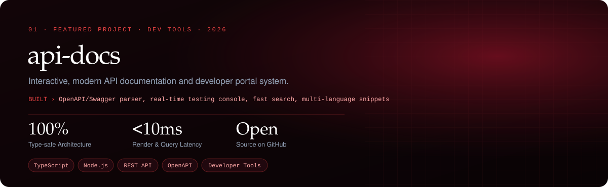</a>
<p align="center">
  <a href="https://github.com/Sosuke-d-Mahi/api-docs"></a>
</p>


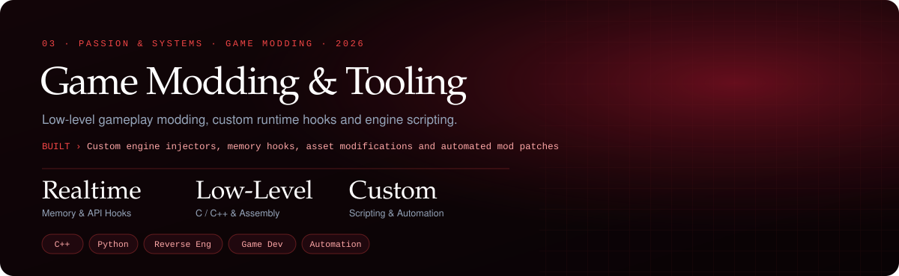

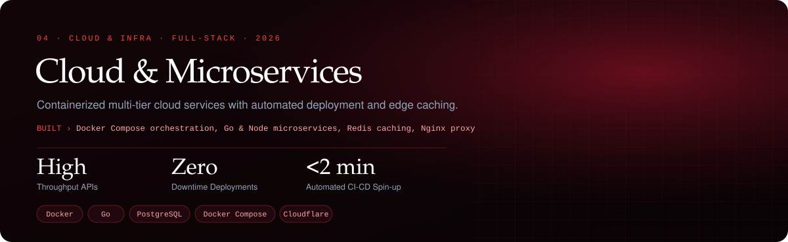

---

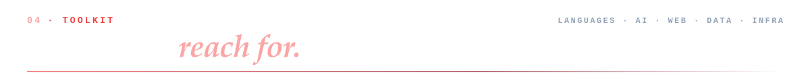
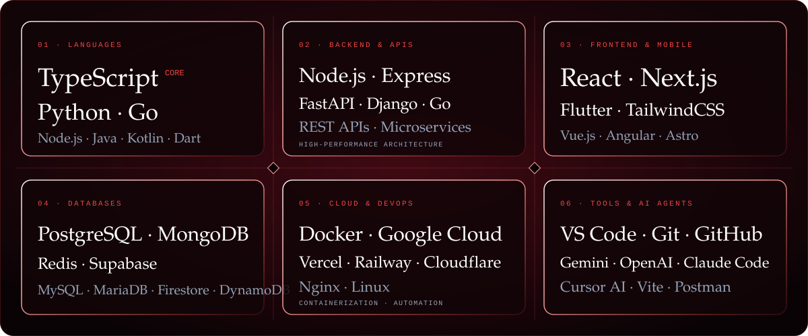

### 🛠️ Tech Stack

<p align="center">
  
  
  
  
  
  
  
  
  
  
  
  
  
  
  
  
  
  
  
  
  
  
  
  
  
  
  
  
  
  
  
  
  
  
  
  
  
  
  
  
  
  
  
  
  
  
  
  
  
  
  
  
  
</p>

---


### 📊 Telemetry

<p align="center">
  
</p>

<p align="center">
  <br />
  <strong>My Statistics</strong>
  <br /><br />
  
</p>

---


<a href="https://www.easirmahi.top/#experience"></a>


<p align="center">
  <a href="mailto:easiriqbalmahi@gmail.com"></a>
  <a href="https://www.linkedin.com/in/easirmahi/"></a>
  <a href="https://github.com/Sosuke-d-Mahi"></a>
  <a href="https://www.easirmahi.top"></a>
</p>

<a href="https://www.easirmahi.top">
  
</a>
